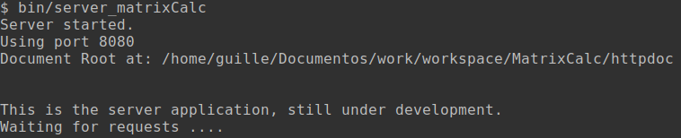
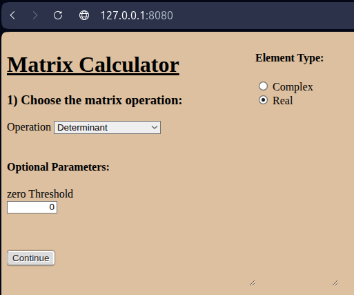

# MatrixCalc
A project to test the arithmetic capabilities of C++ and Javascript when operating using matrices. The further purpose of this poject is to construct a matricial calculator.

## Introduction
This project is under development offering the basic matrix operations in double floating point arithmetic, by now.

## Involved Technologies
The front end is written in vanilla Javascript 8 (ES8 - ECMAScript 2017) and the unique server (backend) in C++17.

## How to use
1. Unpack the archive in the designated directory (i.e /home/\<user\>/projects/MatrixCalc).
2. In the console, run:  bin/server_matrixAlgebra .
   

4. Open the browser and go to the site 127.0.0.1:8080 .
   

6. Enjoy the math 😊 .
